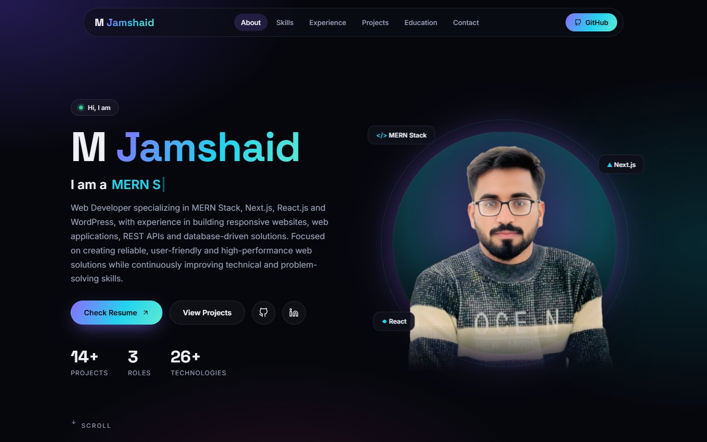
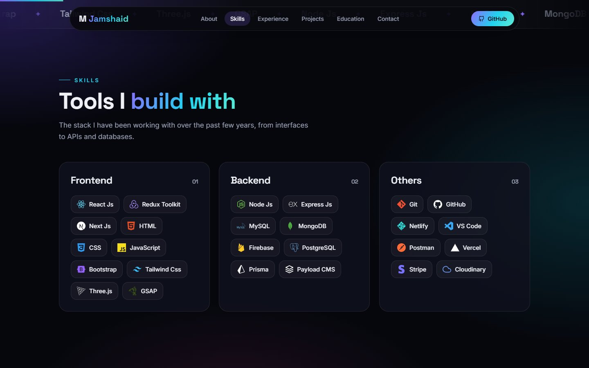
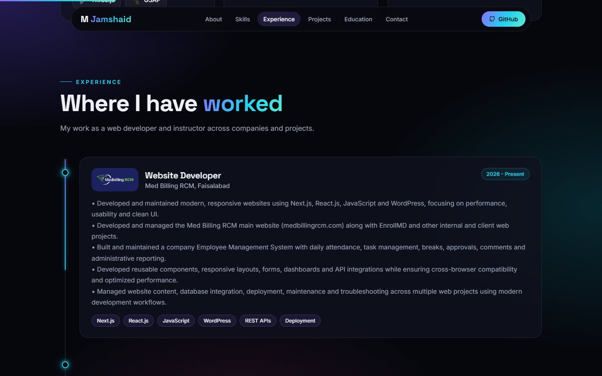
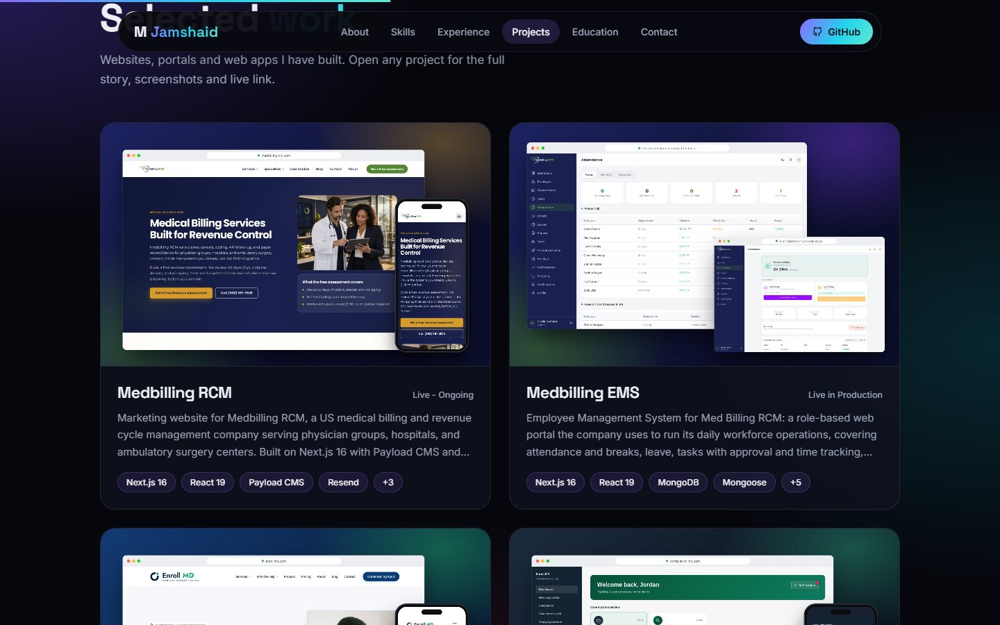

# M Jamshaid - Portfolio

Personal portfolio of **M Jamshaid**, a web developer working with the MERN stack, Next.js, React.js and WordPress. It presents my skills, work experience, education and the websites, portals and web apps I have built.

### Live website: [jamshaid-mu.vercel.app](https://jamshaid-mu.vercel.app/)

## Screenshots

 
 

## Table of Contents
- [Features](#features)
- [Projects Shown](#projects-shown)
- [Technologies Used](#technologies-used)
- [Project Structure](#project-structure)
- [Installation](#installation)
- [Updating Content](#updating-content)
- [Deployment](#deployment)
- [Contact](#contact)

## Features
- **Hero:** introduction with a cutout portrait that tilts gently with the cursor, rotating role titles, and water-ripple rings that follow the mouse.
- **Skills:** a moving skills strip and grouped skill cards with brand icons that ship with the site.
- **Experience:** a timeline that fills as you scroll, with company logos, responsibilities and skill tags.
- **Projects:** project cards with framed mockup covers. Each card opens a popup with the full description, a screenshot gallery and the live link.
- **Education:** degree and training cards.
- **Resume:** the "Check Resume" button opens my resume as a PDF.
- **Contact:** a working contact form powered by EmailJS.
- **Responsive and light:** works on phones, tablets and desktops, with no heavy blur effects or 3D engine.

## Projects Shown
- Medbilling RCM - marketing website
- Medbilling EMS - employee management system
- EnrollMD - medical credentialing website and CMS
- Enroll MD Portal - provider credentialing and enrollment platform
- Billdontix - dental billing website with lead inbox and blog CMS
- SimpleScheduleMD - multi-doctor appointment scheduling and patient portal
- LeadTrack RCM - lead tracking CRM
- Choice Home Health - animated single-page marketing website
- Mind Drape, LIDC, Tech Hub Systems, Jakba, Digital Marketing Platform and Cravy Crunch

## Technologies Used
- **React 18** (Create React App) - user interface
- **styled-components** - styling and theming
- **Framer Motion** - scroll reveals and transitions
- **react-icons** - interface and brand icons
- **Material UI** - project popup and notifications
- **EmailJS** - contact form delivery
- **typewriter-effect** - rotating role titles
- **Vercel** - hosting, with automatic deploys from the `main` branch

## Project Structure
```
public/
  projects/      project mockup images
  logos/         company logos
  M-Jamshaid-Resume.pdf
src/
  data/constants.js     all content: bio, skills, experience, education, projects
  components/           Navbar, HeroSection, Skills, Experience, Projects,
                        ProjectDetails, Education, Contact, Footer, Effects, ui
  utils/Themes.js       colours and gradients
```

## Installation
To run this portfolio locally:

1. Install the dependencies: `npm install`
2. Start the development server: `npm start`
3. Open your browser and visit: `http://localhost:3000`

To create a production build: `npm run build`

## Updating Content
All text and links live in `src/data/constants.js`:

- `Bio` - name, role titles, introduction, resume and social links
- `skills` - skill groups shown in the Skills section
- `experiences` - jobs shown on the timeline
- `education` - degrees and courses
- `projects` - project cards, descriptions, galleries and live links

Project images go in `public/projects/` and company logos in `public/logos/`.

## Deployment
The site is hosted on Vercel. Every push to the `main` branch is built and deployed automatically.

## Contact
- GitHub: [itx-mj65](https://github.com/itx-mj65)
- LinkedIn: [m-jamshaid-48178828b](https://www.linkedin.com/in/m-jamshaid-48178828b/)
- Or use the contact form on the [live website](https://jamshaid-mu.vercel.app/#contact)
